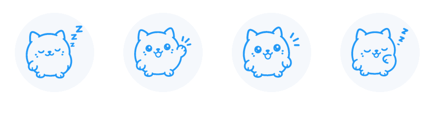

# FreedomCat

[](https://android-arsenal.com/api?level=21)
[](https://github.com/sstpnk/freedom-cat/releases)
[](https://www.gnu.org/licenses/gpl-3.0)

<p align="center">
  
</p>

**[🇷🇺 Русский](#русский)** | **[🇬🇧 English](#english)**

---

## Русский

### Что это такое

**FreedomCat** — самостоятельный прокси-клиент для Android и Android TV на базе
[sing-box](https://github.com/SagerNet/sing-box). Проект вырос из
[NekoBox for Android](https://github.com/MatsuriDayo/NekoBoxForAndroid) (который, в свою очередь,
вырос из SagerNet), но с версии 0.2 это отдельная кодовая база: свои пакеты
`tech.stpnk.freedomcat`, свой интерфейс, свои подписки. Другая архитектура соединения и
обновлённое ядро: профили и подписки из 0.1.x этой версией не подхватываются, их нужно
добавить заново.

Что переделано по сравнению с исходной базой:

- упрощён интерфейс: группы и конфигурации подключений на одном экране;
- поддержка **AmneziaWG**, включая legacy-конфигурации и AmneziaWG 3.1 (см. ниже);
- свой слой подписок: HWID для панелей с привязкой к устройству, понятные ошибки вместо заглушек;
- выкинуто всё, чем я не пользуюсь.

### Возможности

- Работа через VPN-сервис (sing-box) с системным TUN;
- **VLESS + REALITY** на серверах Xray 26+: клиент добавляет пост-квантовый key share
  `X25519MLKEM768`, не подменяя при этом отпечаток браузера из профиля;
- Сплит-туннелирование для приложений: можно гибко выбирать, какие приложения
  идут через VPN, а какие работают напрямую. Функция работает со всеми
  поддерживаемыми протоколами, включая WireGuard, legacy AmneziaWG и AmneziaWG 3.1;
- Управление конфигурациями: группы-карточки со свёртываемыми списками профилей;
- Импорт по ссылке/из буфера обмена/из файла/через QR-код;
- Импорт WireGuard/AmneziaWG-конфигураций из `.conf`, `.vpn`, `wireguard://`, `amneziawg://` и `vpn://`;
- Поддержка подписок (subscription) с обновлением по расписанию;
- Маршрутизация: собственные правила (маршруты), блокировка рекламы, блокировка QUIC;
- Режим VPN для приложений доступен непосредственно из меню;
- Статистика трафика, лог, тест задержек;
- Быстрое переключение сервера и группы.

### Как устроено соединение

```
приложения -> VpnService (TUN, сплит-туннель по приложениям)
                   |
              libcore (sing-box, gomobile)
                   |
     правила маршрутизации -> блокировка рекламы -> outbound
     (VLESS+REALITY, AmneziaWG, Shadowsocks, Hysteria, ...)
```

- **TUN и сплит-туннель** живут в `VpnService`: приложение либо разрешено в туннель, либо
  исключено из него на уровне системы, ядро об этом ничего не знает.
- **Ядро** — `libcore.aar` из нашего форка sing-box
  ([sstpnk/sing-box](https://github.com/sstpnk/sing-box), ветка `awg`), собранный через
  `gomobile`. Коммит закреплён в `buildScript/lib/core/get_source_env.sh`, поэтому CI и
  локальная сборка собирают одно и то же. Релизный скрипт дополнительно проверяет, что
  `libgojni.so` в APK побайтово совпадает с библиотекой внутри `libcore.aar`.
- **DNS**: удалённый DoH плюс fakeip; правила маршрутизации и блокировка рекламы
  применяются до выбора outbound.
- **VLESS + REALITY**: отпечаток браузера берётся из профиля и не подменяется, а к нему
  добавляется пост-квантовый key share `X25519MLKEM768` — так клиент проходит и на старых
  серверах, и на Xray 26+, которые без этого share отказывают. В `session_id` при этом
  сообщается актуальная версия клиента: серверы умеют требовать минимальную. Детали и
  история отладки — в [docs/dual-core-plan.md](docs/dual-core-plan.md).
- **Блокировка рекламы**: список `adblock.srs` скачивается самим приложением (jsdelivr,
  затем raw GitHub, при необходимости — через уже поднятый туннель) в рабочий каталог
  sing-box. Если файла нет, правило просто пропускается: туннель поднимается в любом
  случае.
- **Подписки**: запросы уходят с HWID и заголовками клиента, профили при обновлении
  сравниваются полностью, поэтому смена `short_id` на стороне панели подхватывается, а
  заглушки «приложение не поддерживается» распознаются отдельной проверкой.

### Поддержка WireGuard и AmneziaWG

**AmneziaWG** — это протокол на основе WireGuard с дополнительным шифрованием трафика,
который скрывает характер соединения от DPI и позволяет обходить глубокую фильтрацию
трафика. Протокол разработан проектом [AmneziaVPN](https://github.com/amnezia-vpn)
и совместим с серверами AmneziaVPN.

В этом форке поддержка AmneziaWG реализована следующим образом:

1. **sing-box**: в наш форк
   [sstpnk/sing-box](https://github.com/sstpnk/sing-box) (ветка `awg`) портирован
   эндпоинт AmneziaWG (`awg`) поверх [amneziawg-go](https://github.com/amnezia-vpn/amneziawg-go);
2. **libcore (gomobile)**: обновлённая библиотека подключает порт sing-box с AmneziaWG;
3. **Разбор конфигураций**: поддерживаются обычный WireGuard, legacy AmneziaWG
   (`Jc`, `Jmin`, `Jmax`, `S1`, `S2`, `H1`-`H4`) и AmneziaWG 3.1 с новыми
   параметрами endpoint;
4. **Импорт**: поддерживаются `.conf`, `.vpn`, `wireguard://`, `amneziawg://`
   и `vpn://`, включая экспорт из приложения Amnezia;
5. **Интерфейс**: AmneziaWG-профили корректно отображаются как `AmneziaWG`
   и доступны для ручного редактирования параметров.

Благодарим за наработки сообщество AmneziaVPN — без них сама идея бы не нашла воплощения.

### Список поддерживаемых протоколов

- SOCKS (4/4a/5)
- HTTP(S)
- SSH
- Shadowsocks
- VMess
- Trojan
- VLESS
- AnyTLS
- ShadowTLS
- TUIC
- Hysteria 1/2
- WireGuard
- **AmneziaWG**
- Trojan-Go (trojan-go-plugin)
- NaïveProxy (naive-plugin)
- Mieru (mieru-plugin)

### Форматы подписок

- Распространённые форматы (Shadowsocks, ClashMeta, v2rayN и т.п.)
- sing-box outbound

### Сборка из исходников

Требуется: JDK 17+, Android SDK (platform 35), Android NDK.

Ядро `libcore` собирается из нашего форка sing-box
([sstpnk/sing-box](https://github.com/sstpnk/sing-box)): в нём живёт патч
совместимости REALITY и порт AmneziaWG. Перед сборкой запустите
`bash buildScript/lib/core/get_source.sh`: скрипт клонирует репозитории в `deps/` внутри
проекта и переключает их на коммиты из `buildScript/lib/core/get_source_env.sh`.
Каталог `deps/` локальный, перечислен в `.gitignore` и в репозиторий не попадает.

```bash
git clone --recurse-submodules https://github.com/sstpnk/freedom-cat.git
cd freedom-cat
bash buildScript/lib/core/get_source.sh
./gradlew :app:assembleOssRelease
```

### Лицензия

Проект распространяется под лицензией [GPL-3.0](LICENSE).

### Благодарности

FreedomCat — это форк, поэтому в первую очередь мы благодарим авторов оригинальных
проектов:

**NekoBox for Android**

- [MatsuriDayo/NekoBoxForAndroid](https://github.com/MatsuriDayo/NekoBoxForAndroid)

**SagerNet**

- [SagerNet/SagerNet](https://github.com/SagerNet/SagerNet) и лично
  [nekohasekai](https://github.com/nekohasekai) — автор SagerNet / NB4A;

**sing-box / ядро**

- [SagerNet/sing-box](https://github.com/SagerNet/sing-box) — ядро, на котором всё работает;

**gomobile / инструменты сборки**

- [MatsuriDayo/gomobile](https://github.com/MatsuriDayo/gomobile) — сборка Go-ядра в AAR;

**Протокол AmneziaWG**

- [AmneziaVPN](https://github.com/amnezia-vpn) / [amneziawg-go](https://github.com/amnezia-vpn/amneziawg-go);

**Веб-панель**

- [Yacd-meta](https://github.com/MetaCubeX/Yacd-meta);

**Прочие вдохновляющие проекты**

- [shadowsocks/shadowsocks-android](https://github.com/shadowsocks/shadowsocks-android)

Полный список контрибьюторов оригинальных проектов можно посмотреть в их репозиториях:
[NekoBox for Android contributors](https://github.com/MatsuriDayo/NekoBoxForAndroid/graphs/contributors),
[SagerNet contributors](https://github.com/SagerNet/SagerNet/graphs/contributors).

---

## English

### What is this

**FreedomCat** is a standalone proxy client for Android and Android TV built on
[sing-box](https://github.com/SagerNet/sing-box). It grew out of
[NekoBox for Android](https://github.com/MatsuriDayo/NekoBoxForAndroid), which itself grew out of
SagerNet, but since 0.2 it is a separate codebase: its own `tech.stpnk.freedomcat` packages,
its own UI and its own subscription stack. 0.2.1 is the first release of that line, so
profiles and subscriptions from 0.1.x are not carried over.

What is different from the source base:

- simplified the UI (groups and connection configurations are now on a single screen);
- **AmneziaWG** support, including legacy configs and AmneziaWG 3.1 (see below);
- own subscription layer: HWID for device-bound panels, readable errors instead of placeholder profiles;
- removed everything I don't use.

### Features

- VPN service (sing-box) with system TUN;
- **VLESS + REALITY** against Xray 26+ servers: the client adds the post-quantum
  `X25519MLKEM768` key share without replacing the browser fingerprint from the profile;
- Per-app split tunneling: choose which apps go through VPN and which apps stay
  direct. This works with every supported protocol, including WireGuard, legacy
  AmneziaWG and AmneziaWG 3.1;
- Configuration management: group cards with collapsible profile lists;
- Import by link / from clipboard / from file / via QR code;
- WireGuard/AmneziaWG import from `.conf`, `.vpn`, `wireguard://`, `amneziawg://` and `vpn://`;
- Subscription support with scheduled updates;
- Routing: custom rules (routes), ad blocking, QUIC blocking;
- Apps VPN mode is available directly from the menu;
- Traffic statistics, log, latency testing;
- Fast server and group switching.

### How a connection is built

```
apps -> VpnService (TUN, per-app split tunnelling)
             |
         libcore (sing-box, gomobile)
             |
   routing rules -> ad blocking -> outbound
   (VLESS+REALITY, AmneziaWG, Shadowsocks, Hysteria, ...)
```

- **TUN and per-app split tunnelling** live in `VpnService`: an app is either allowed into
  the tunnel or excluded from it by the system, the core never sees that decision.
- **The core** is `libcore.aar`, built with `gomobile` from our sing-box fork
  ([sstpnk/sing-box](https://github.com/sstpnk/sing-box), branch `awg`). The commit is
  pinned in `buildScript/lib/core/get_source_env.sh`, so CI and a local build compile the
  same code, and the release script verifies that `libgojni.so` inside the APK matches the
  library in `libcore.aar` byte for byte.
- **DNS** is remote DoH plus fakeip; routing rules and ad blocking run before the outbound
  is chosen.
- **VLESS + REALITY**: the browser fingerprint from the profile is kept, and the
  post-quantum `X25519MLKEM768` key share is added to it. That combination works with both
  older servers and Xray 26+ servers, which reject a hello without the share. The session id
  reports a current client version because servers can enforce a minimum. Background and
  debugging notes: [docs/dual-core-plan.md](docs/dual-core-plan.md).
- **Ad blocking**: `adblock.srs` is downloaded by the app itself (jsdelivr, then raw
  GitHub, through the running tunnel when needed) into the sing-box working directory. When
  the file is missing the rule is skipped, so a failed download can never keep the tunnel
  down.
- **Subscriptions**: requests carry HWID and client headers, profiles are compared in full
  on refresh (so a rotated `short_id` is picked up), and "app not supported" placeholders
  are detected explicitly.

### WireGuard and AmneziaWG support

**AmneziaWG** is a WireGuard-based protocol with additional traffic encryption that
hides the connection signature from DPI and helps bypass deep traffic filtering.
The protocol was created by the [AmneziaVPN](https://github.com/amnezia-vpn) project
and is compatible with AmneziaVPN servers.

In this fork, AmneziaWG support is implemented as follows:

1. **sing-box**: our fork [sstpnk/sing-box](https://github.com/sstpnk/sing-box)
   (branch `awg`) includes the AmneziaWG (`awg`) endpoint built on top of
   [amneziawg-go](https://github.com/amnezia-vpn/amneziawg-go);
2. **libcore (gomobile)**: the updated library links the sing-box port with AmneziaWG;
3. **Config parsing**: plain WireGuard, legacy AmneziaWG (`Jc`, `Jmin`, `Jmax`,
   `S1`, `S2`, `H1`-`H4`) and AmneziaWG 3.1 endpoint parameters are supported;
4. **Import**: `.conf`, `.vpn`, `wireguard://`, `amneziawg://` and `vpn://`
   imports are supported, including exports from the Amnezia app;
5. **UI**: AmneziaWG profiles are shown as `AmneziaWG` and their connection
   parameters can be edited manually.

Thanks to the AmneziaVPN community for their work — without them this idea would
never have come to life.

### Supported proxy protocols

- SOCKS (4/4a/5)
- HTTP(S)
- SSH
- Shadowsocks
- VMess
- Trojan
- VLESS
- AnyTLS
- ShadowTLS
- TUIC
- Hysteria 1/2
- WireGuard
- **AmneziaWG**
- Trojan-Go (trojan-go-plugin)
- NaïveProxy (naive-plugin)
- Mieru (mieru-plugin)

### Supported subscription formats

- Widely used formats (like Shadowsocks, ClashMeta and v2rayN)
- sing-box outbound

### Building from source

Requirements: JDK 17+, Android SDK (platform 35), Android NDK.

`libcore` is built from our sing-box fork
([sstpnk/sing-box](https://github.com/sstpnk/sing-box)), which carries the REALITY
interoperability patch and the AmneziaWG endpoint. Run
`bash buildScript/lib/core/get_source.sh` first: it clones the repositories into
`deps/` inside the project and checks out the revisions pinned in
`buildScript/lib/core/get_source_env.sh`. `deps/` is local-only, listed in
`.gitignore`, and never committed.

```bash
git clone --recurse-submodules https://github.com/sstpnk/freedom-cat.git
cd freedom-cat
bash buildScript/lib/core/get_source.sh
./gradlew :app:assembleOssRelease
```

### License

The project is distributed under the [GPL-3.0](LICENSE) license.

### Credits

FreedomCat is a fork, so first of all I would like to thank the authors of the
original projects:

**NekoBox for Android**

- [MatsuriDayo/NekoBoxForAndroid](https://github.com/MatsuriDayo/NekoBoxForAndroid)

**SagerNet**

- [SagerNet/SagerNet](https://github.com/SagerNet/SagerNet) and personally
  [nekohasekai](https://github.com/nekohasekai) — author of SagerNet / NB4A;

**sing-box / core**

- [SagerNet/sing-box](https://github.com/SagerNet/sing-box) — the core everything runs on;

**gomobile / build tooling**

- [MatsuriDayo/gomobile](https://github.com/MatsuriDayo/gomobile) — builds the Go core into an AAR;

**AmneziaWG protocol**

- [AmneziaVPN](https://github.com/amnezia-vpn) / [amneziawg-go](https://github.com/amnezia-vpn/amneziawg-go);

**Web dashboard**

- [Yacd-meta](https://github.com/MetaCubeX/Yacd-meta);

**Other inspiring projects**

- [shadowsocks/shadowsocks-android](https://github.com/shadowsocks/shadowsocks-android)

Full contributor lists of the original projects can be found in their repositories:
[NekoBox for Android contributors](https://github.com/MatsuriDayo/NekoBoxForAndroid/graphs/contributors),
[SagerNet contributors](https://github.com/SagerNet/SagerNet/graphs/contributors).
